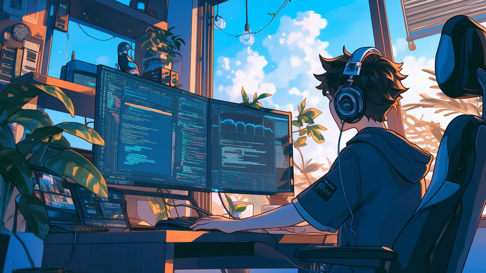
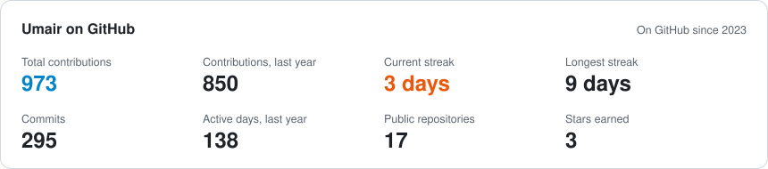
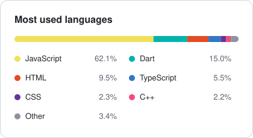
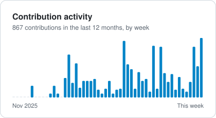

<!-- ═══════════════════════════════════════════════════════════════════════ -->
<!--  Sections between START_SECTION / END_SECTION markers are written by     -->
<!--  .github/workflows/update-readme.yml every 6 hours. Edit everything else -->
<!--  by hand, but keep those markers.                                        -->
<!--  Owner: Umair Habib. Last reviewed: Nov 2026. Review the hand-written     -->
<!--  parts when your role changes, you ship a new flagship project, you start -->
<!--  a job search, or you give a talk.                                        -->
<!-- ═══════════════════════════════════════════════════════════════════════ -->

<p align="center">
  
</p>

<h1 align="center">Umair Habib</h1>
<p align="center"><b>Associate Software Engineer</b> · Full-Stack Web &amp; Mobile Developer</p>
<p align="center">I ship full-stack web and mobile products end to end (SaaS platforms, ERPs and education portals) with Next.js, Flutter and Python.</p>

<p align="center">
  <a href="https://umairhabib.vercel.app/">
    
  </a>
  <br/>
  <a href="https://umairhabib.vercel.app/">
    
  </a>
</p>

<p align="center">
  <a href="https://umairhabib.vercel.app/?ref=github-profile"></a>
  <a href="https://www.linkedin.com/in/umair-habib-developer/"></a>
  <a href="mailto:umairhabibabc@gmail.com"></a>
  
</p>


<!-- ═══════════════════════════ FEATURED PROJECTS ═════════════════════════ -->

## 🚀 Featured Projects

<!-- Pin repositories on your profile to choose these. Otherwise the best public repos are picked. -->
<!--START_SECTION:featured-->
<table>
<tr>
<td width="50%" valign="top">
<h3><a href="https://github.com/Umair-Habibx123/collaborative-edge">collaborative-edge</a></h3>
<p>MERN portal connecting industry, teachers and students around final-year projects: post ideas, approve, supervise, submit and evaluate. Includes a…</p>
<p><code>JavaScript</code> &nbsp;·&nbsp; <a href="https://collaborative-edge.vercel.app">Live demo</a></p>
<p><sub><code>#fyp</code> <code>#javascript</code> <code>#mern-stack</code> <code>#nodejs</code></sub></p>
</td>
<td width="50%" valign="top">
<h3><a href="https://github.com/Umair-Habibx123/firestream">firestream</a></h3>
<p>Real-time Flutter chat app for Android with Firebase: one-to-one and group chats, images, files and voice notes, admin-controlled groups, online…</p>
<p><code>Dart</code> &nbsp;·&nbsp; ⭐ 1</p>
<p><sub><code>#android-app</code> <code>#chat-application</code> <code>#dart</code> <code>#firebase</code></sub></p>
</td>
</tr>
<tr>
<td width="50%" valign="top">
<h3><a href="https://github.com/Umair-Habibx123/pakistan-education-portal">pakistan-education-portal</a></h3>
<p>Angular 16 frontend for searching Pakistani universities and programs and applying for admission, with an admin panel. Built with a team during my…</p>
<p><code>TypeScript</code> &nbsp;·&nbsp; <a href="https://pakistaneducationportal.com">Live demo</a></p>
<p><sub><code>#angular</code> <code>#bootstrap</code> <code>#educational-project</code> <code>#portal</code></sub></p>
</td>
<td width="50%" valign="top">
<h3><a href="https://github.com/Umair-Habibx123/ec3-store">ec3-store</a></h3>
<p>Full-stack React e-commerce store: Firebase auth and Firestore, Stripe checkout with server-side pricing, cash on delivery, and an admin dashboard.</p>
<p><code>JavaScript</code> &nbsp;·&nbsp; <a href="https://ec3store.vercel.app">Live demo</a></p>
<p><sub><code>#ecommerce</code> <code>#ecommerce-website</code> <code>#firebase</code> <code>#full-stack</code></sub></p>
</td>
</tr>
<tr>
<td width="50%" valign="top">
<h3><a href="https://github.com/Umair-Habibx123/gemini-ai-app">gemini-ai-app</a></h3>
<p>Flutter chat app for Android powered by Google Gemini: text, images, voice notes, video, PDFs and files, streamed Markdown answers, model fallback…</p>
<p><code>Dart</code> &nbsp;·&nbsp; ⭐ 1</p>
<p><sub><code>#android-app</code> <code>#api</code> <code>#chatbot</code> <code>#dart</code></sub></p>
</td>
<td width="50%" valign="top">
<h3><a href="https://github.com/Umair-Habibx123/news-app">news-app</a></h3>
<p>Flutter news reader for Android: headlines by category, search, offline bookmarks, English/Urdu/Arabic UI, light and dark themes. Signed APKs in…</p>
<p><code>Dart</code> &nbsp;·&nbsp; ⭐ 1</p>
<p><sub><code>#android-app</code> <code>#apis</code> <code>#dart</code> <code>#flutter</code></sub></p>
</td>
</tr>
</table>
<!--END_SECTION:featured-->

<p align="center">
  <a href="https://github.com/Umair-Habibx123?tab=repositories&sort=updated">
    
  </a>
</p>

<!-- ═══════════════════════════════ ABOUT ═════════════════════════════════ -->

## 👨‍💻 About Me

<table>
<tr>
<td width="62%" valign="top">

```typescript
const umair = {
  role:      "Associate Software Engineer @ galvanai",
  based:     "Rawalpindi / Islamabad, Pakistan 🇵🇰",
  education: "B.S. Software Engineering — NUML (2021–2025)",
  focus:     ["Full-Stack Web", "Mobile", "AI-powered SaaS"],
  frontend:  ["Next.js", "React", "Angular", "TypeScript"],
  mobile:    ["Flutter", "Android"],
  backend:   ["Python", "Flask", "Node.js", "REST APIs"],
  data:      ["PostgreSQL", "Firebase", "SQLite", "AWS"],
  values:    ["Scalable architecture", "Clean code"],
};
```

</td>
<td width="38%" valign="top" align="center">


</td>
</tr>
</table>

> Associate Software Engineer with **1.5+ years** of professional experience delivering full-stack
> web and mobile applications, with a track record of shipping SaaS platforms, ERP systems,
> and large-scale education portals.


<!-- ═══════════════════════════════ TECH STACK ════════════════════════════ -->

## 🛠️ Tech Stack

**Frontend**

<p>
  
</p>

**Mobile · Backend · Data &amp; Cloud**

<p>
  
  <br/>
  
</p>

<!-- ═══════════════════════════════ GITHUB STATS ══════════════════════════ -->

## 📊 GitHub Stats

<p align="center">
  <picture>
    <source media="(prefers-color-scheme: dark)" srcset="./assets/generated/overview-dark.svg" />
    
  </picture>
</p>

<p align="center">
  <picture>
    <source media="(prefers-color-scheme: dark)" srcset="./assets/generated/languages-dark.svg" />
    
  </picture>
  <picture>
    <source media="(prefers-color-scheme: dark)" srcset="./assets/generated/activity-dark.svg" />
    
  </picture>
</p>

<!-- ═══════════════════════════ RECENT WORK ═══════════════════════════════ -->

## 🔨 Recently Updated

<!--START_SECTION:recent-->
- **[firestream](https://github.com/Umair-Habibx123/firestream)** — Real-time Flutter chat app for Android with Firebase: one-to-one and group chats, images… · `Dart` · <sub>updated Nov 9, 2026</sub>
- **[attendy-sqlite](https://github.com/Umair-Habibx123/attendy-sqlite)** — Offline attendance app for Android (Flutter + SQLite): check-ins, leave and admin… · `Dart` · <sub>updated Nov 9, 2026</sub>
- **[gemini-ai-app](https://github.com/Umair-Habibx123/gemini-ai-app)** — Flutter chat app for Android powered by Google Gemini: text, images, voice notes, video… · `Dart` · <sub>updated Nov 9, 2026</sub>
- **[news-app](https://github.com/Umair-Habibx123/news-app)** — Flutter news reader for Android: headlines by category, search, offline bookmarks… · `Dart` · <sub>updated Nov 9, 2026</sub>
- **[pakistan-education-portal](https://github.com/Umair-Habibx123/pakistan-education-portal)** — Angular 16 frontend for searching Pakistani universities and programs and applying for… · `TypeScript` · <sub>updated Nov 9, 2026</sub>
<!--END_SECTION:recent-->

## ⚡ Recent Activity

<!--START_SECTION:activity-->
<sub>Last 30 days</sub>

- ⬆️ Pushed 1 commit to [firestream](https://github.com/Umair-Habibx123/firestream) <sub>· Nov 9, 2026</sub>
- ⬆️ Pushed 1 commit to [pakistan-youth-portal](https://github.com/Umair-Habibx123/pakistan-youth-portal) <sub>· Nov 9, 2026</sub>
- ⬆️ Pushed 1 commit to [portfolio-aspnet-mvc](https://github.com/Umair-Habibx123/portfolio-aspnet-mvc) <sub>· Nov 9, 2026</sub>
- ⬆️ Pushed 1 commit to [atm-machine-cpp](https://github.com/Umair-Habibx123/atm-machine-cpp) <sub>· Nov 9, 2026</sub>
- ⬆️ Pushed 1 commit to [gemini-ai-app](https://github.com/Umair-Habibx123/gemini-ai-app) <sub>· Nov 9, 2026</sub>
- ⬆️ Pushed 1 commit to [outpost-last-watch-mango-mania-season-1](https://github.com/Umair-Habibx123/outpost-last-watch-mango-mania-season-1) <sub>· Nov 9, 2026</sub>
<!--END_SECTION:activity-->

<!-- ═══════════════════════════ CONTRIBUTION SNAKE ════════════════════════ -->

## 🐍 Contribution Snake

<p align="center">
  <picture>
    <source media="(prefers-color-scheme: dark)" srcset="https://raw.githubusercontent.com/Umair-Habibx123/Umair-Habibx123/output/github-snake-dark.svg" />
    
  </picture>
</p>

<div align="center">
<details>
  <summary><b>🖥️ &nbsp;Peek at my workspace</b></summary>
  <br/>
  
</details>
</div>

<!-- ═══════════════════════════════ CONNECT ═══════════════════════════════ -->

## 📫 Let's Connect

Happy to talk about full-stack, web and mobile work, or to collaborate on an interesting product.
The quickest way to reach me is [LinkedIn](https://www.linkedin.com/in/umair-habib-developer/) or [email](mailto:umairhabibabc@gmail.com), and you can see more of my work on my [portfolio](https://umairhabib.vercel.app/?ref=github-profile).

<p align="center">
  
</p>

<p align="center">
<!--START_SECTION:updated-->
<sub>Updated automatically from live GitHub data · Nov 9, 2026, 10:25 PM UTC</sub>
<!--END_SECTION:updated-->
</p>
